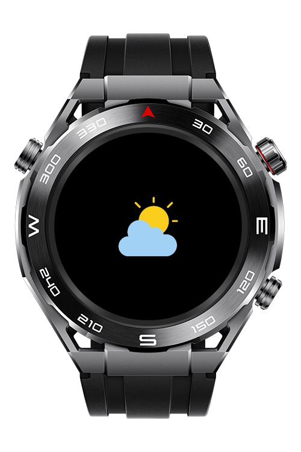
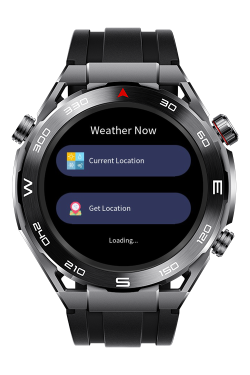
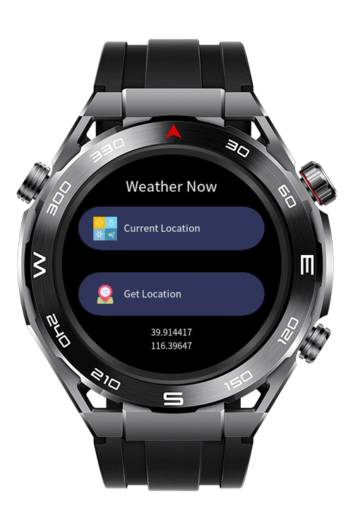
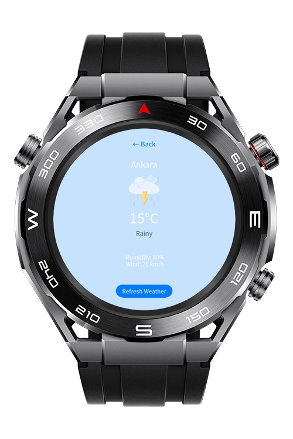

> **Note:** To access all shared projects, get information about environment setup, and view other guides, please visit [Explore-In-HMOS-Wearable Index](https://github.com/Explore-In-HMOS-Wearable/hmos-index).

# WeatherNow

WeatherNow is a HarmonyOS Lite Wearable application that shows the current weather. It uses the Location Kit to get the device’s location and displays weather information such as temperature, weather conditions, and more, directly on your wrist.

# Preview
<div>
  
  
  
  
</div>

# Use Cases

**Current Weather Display:** Currently, the app simulates weather conditions using example (mock) data.

**Wearable Convenience:** Designed specifically for HarmonyOS Lite Wearable devices, providing quick and glanceable weather information.

**Developer Learning:** Serves as a practical example for developers to understand weather data display on Lite Wearable devices and prepare for future Location Kit integration.

# Technology

## Stack

**Languages:** JavaScript
**Frameworks:** HarmonyOS SDK 5.0.0 (API 12)
**Tools:** DevEco Studio
**APIs:** @system.geolocation

## Required Permissions

* ```ohos.permission.LOCATION```

# Directory Structure

```
entry/src/main/
|---js/MainAbility
  |---icons
  |---pages
  |   |---index                  // Splash page (icon only)
  |   |   |---index.hml          // UI layout: only app icon and brief intro
  |   |   |---index.css          // Simple styling: background, icon positioning
  |   |   |---index.js           // Transition logic or auto-redirect to main page after a short delay
  |   
  |   |---main                   // Main menu page
  |   |   |---main.hml           // UI layout: two buttons (Current Weather, Settings or similar)
  |   |   |---main.css           // Styling: button placement, colors
  |   |   |---main.js            // Button click logic and page navigation
  |
  |   |---current                // Current weather page
  |   |   |---current.hml        // UI layout: displays mock weather data
  |   |   |---current.css        // Styling: background, temperature and condition colors
  |   |   |---current.js         // Load mock data and handle page interactions
```


# Constraints and Restrictions

## Supported Device
- Huawei Sport (Lite) Watch GT 4/5/6
- Huawei Sport (Lite) GT4/5 Pro
- Huawei Sport (Lite) Fit 3/4
- Huawei Sport (Lite) D2
- Huawei Sport (Lite) Ultimate

# License

WeatherNow is distributed under the terms of the MIT License.

See the [LICENSE](/LICENSE) for more information.